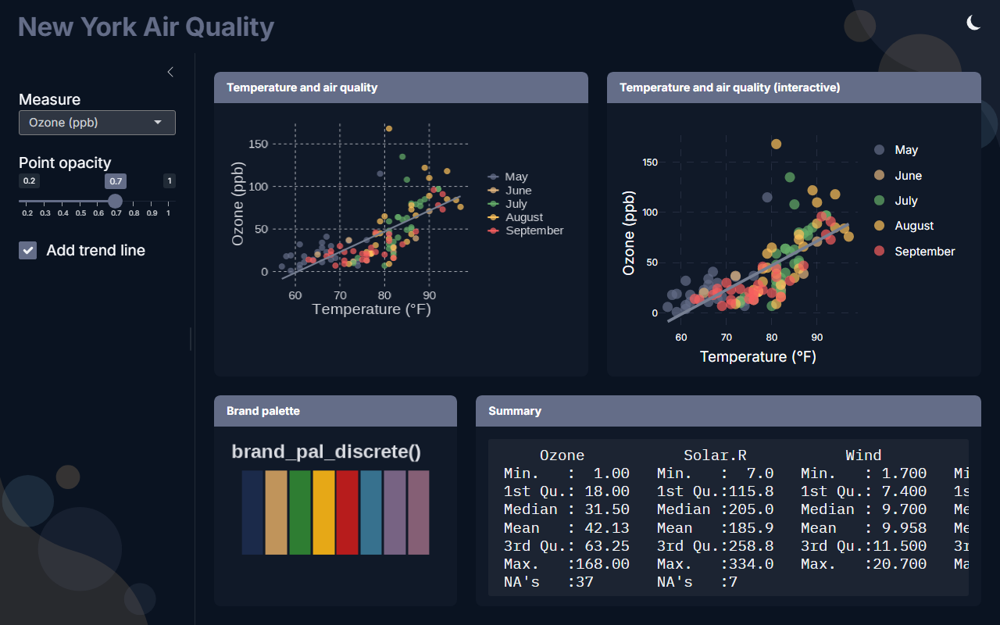
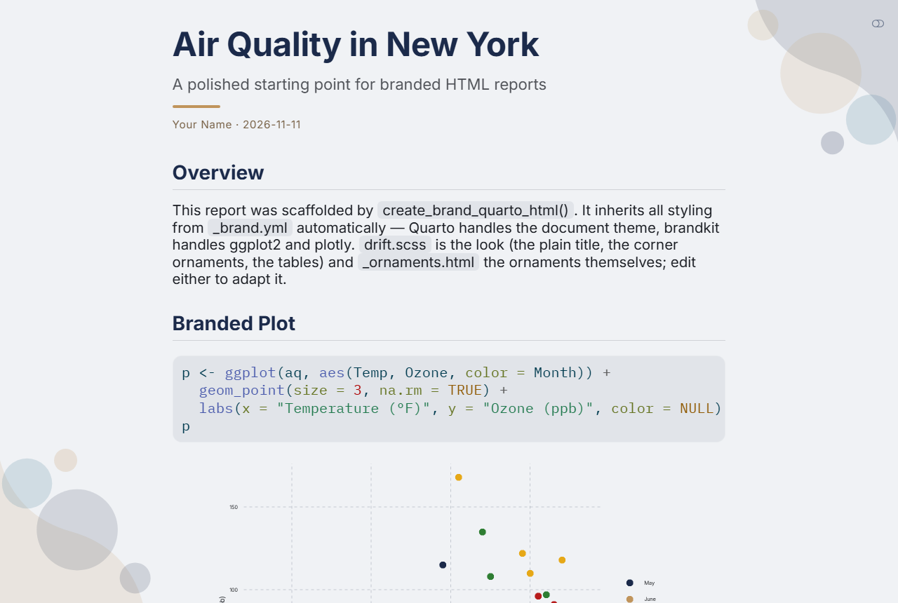
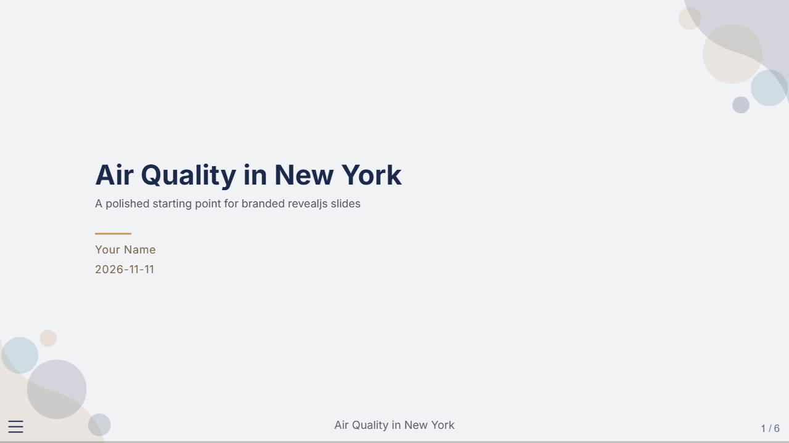
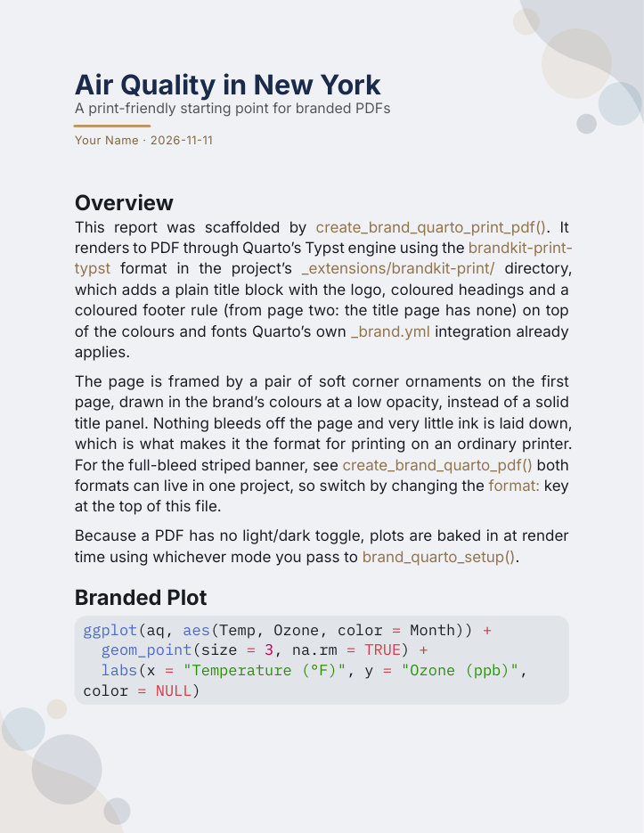
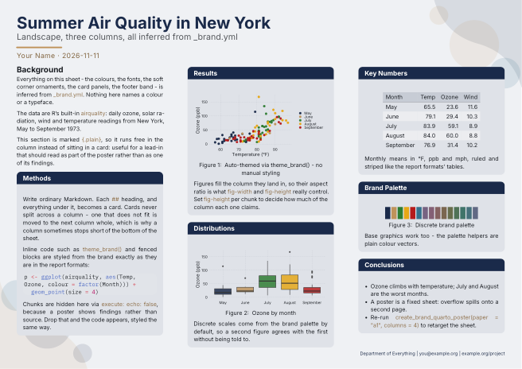

# brandkit

**Opinionated brand theming for R: configure once, apply everywhere.**

brandkit turns one `_brand.yml` into consistent theming across Shiny apps,
ggplot2 and plotly charts, Quarto reports, slide decks, dashboards, PDFs and
conference posters. It builds on the [brand.yml](https://posit-dev.github.io/brand-yml/)
ecosystem, using bslib and Quarto's own brand support for the page itself, and
adds what sits around it:

- an interactive **configurator** that writes the brand file;
- **auto-applied defaults** for ggplot2, plotly and Shiny plots, light and dark;
- **page wrappers** and **project templates** for Shiny and Quarto;
- CSS for third-party widgets Bootstrap doesn't reach, and a Typst extension
  for PDFs and posters.



## Installation

```r
devtools::install_github("LukasWillocx/brandkit", build_vignettes = TRUE)

# or pin a release (see NEWS.md for what changed in each)
devtools::install_github("LukasWillocx/brandkit@v0.3.0")
```

R 4.1 or later, bslib 0.9 or later, and (for the document templates) Quarto 1.8
or later. Suggested packages are needed only for the feature named:

| Package | Needed for |
|---|---|
| `plotly`, `htmlwidgets` | `brand_plotly()` |
| `gt`, `DT`, `leaflet` | branded tables and maps in your apps |
| `showtext`, `sysfonts` | brand fonts in ggplot2 and base graphics |
| `knitr`, `quarto` | the Quarto templates |
| `httpuv` | clearing a stuck `runApp()` before the configurator starts |

## Quick start

**1. Make a brand.** Pick colours and fonts, add a logo, and save `_brand.yml`.

```r
library(brandkit)
configure_brand()
```

**2. Use it in Shiny.** Swap the page function; nothing else changes.

```r
library(shiny); library(bslib); library(ggplot2); library(brandkit)

ui <- brand_page_sidebar(
  title = "New York air quality",
  sidebar = sidebar(selectInput("var", "Variable", c("Temp", "Wind", "Solar.R"))),
  card(card_header("Ozone"), plotOutput("plot"))
)

server <- function(input, output, session) {
  output$plot <- renderPlot(
    ggplot(airquality, aes(.data[[input$var]], Ozone, colour = factor(Month))) +
      geom_point(size = 3)
  )
}

shinyApp(ui, server)
```

No `theme =`, no `theme_brand()`, no colour scale, no dark-mode code. The theme,
a dark-mode toggle, the logo and the plot styling are all injected, and plots
follow the toggle.

**3. Or start from a template.** Each scaffold writes a working, branded project
(plus the `_brand.yml` in the format that target needs):

```r
create_brand_shiny_app("my-app")
create_brand_quarto_html("my-report")
```

## What you get

| I want to... | Use |
|---|---|
| Write a branded Shiny app | `brand_page_sidebar()`, `brand_page_navbar()`, `brand_page_fluid()` |
| Make plots match | automatic after `library(brandkit)`; or `theme_brand()` and `scale_*_brand_*()` |
| Make interactive plots match | `brand_plotly()` |
| Follow light and dark mode | automatic for plots in apps; `brand_dark_mode()` for everything else |
| Brand a Quarto document | `brand_quarto_setup()`, and the `create_brand_quarto_*()` templates |
| Get the brand's colours, fonts or logo | `brand_colors()`, `brand_fonts()`, `brand_logo()`, `brand_pal_*()` |
| Add a corner ornament to anything | `brand_ornament()`, `brand_ornaments_tag()` |
| Change the brand | `configure_brand()` |

## Templates

| Function | Gives you | Look |
|---|---|---|
| `create_brand_shiny_app()` | sidebar app: inputs, a ggplot and a plotly chart | drift |
| `create_brand_shiny_dashboard()` | KPI dashboard: value boxes, tabs, a DT table | classic |
| `create_brand_shiny_map()` | leaflet map with a brand colour ramp and tiles that follow the mode | classic |
| `create_brand_shiny_steps()` | a workflow in order, with numbered steps in the sidebar | drift |
| `create_brand_quarto_html()` | HTML report with a light/dark toggle | drift |
| `create_brand_quarto_slides()` | revealjs slide deck | drift |
| `create_brand_quarto_dashboard()` | Quarto dashboard on a Shiny runtime | drift |
| `create_brand_quarto_pdf()` | PDF via Typst, full-bleed striped banner | striped |
| `create_brand_quarto_print_pdf()` | PDF via Typst, plain masthead, kind to printers | drift |
| `create_brand_quarto_poster()` | landscape conference poster via Typst, A0 to A4 | drift |

"Drift" is the shared look: soft corner ornaments drawn in the brand's colours,
the title as plain type, and tinted cards. Every scaffold creates its directory
if needed and never overwrites anything unless you pass `overwrite = TRUE`.

### Gallery

| HTML report | Slides |
|---|---|
|  |  |

| Print-friendly PDF | Poster |
|---|---|
|  |  |

## The brand file

A `_brand.yml` follows the brand.yml specification:

```yaml
meta:
  name: My Brand
color:
  primary: "#2c3e50"
  secondary: "#1abc9c"
  # success, danger, warning, info, light, dark, foreground, background
typography:
  fonts:
    - family: Inter
      source: google
  base: { family: Inter, size: 1rem }
  headings: { family: Montserrat, weight: 700 }
logo:
  medium: "logo/brand.png"
```

Shiny (bslib) and Quarto read this file differently when it comes to dark
colours, so it comes in two dialects. You rarely have to think about it: the
configurator writes whichever you choose, and each scaffold converts the file to
the form its target needs. The details are in the first vignette.

## Learn more

The documentation is a set of articles in [`vignettes/`](vignettes/). Installed
with `build_vignettes = TRUE` they open with `vignette("name", package =
"brandkit")`; the links below read them on GitHub.

| Article | Covers |
|---|---|
| [Getting started](vignettes/getting-started.Rmd) | the brand file, the configurator, the two dialects, reading the brand from R |
| [Branded Shiny apps](vignettes/shiny-apps.Rmd) | the page wrappers, the drift style, light and dark mode, tables, maps, the four app templates |
| [Plots](vignettes/plots.Rmd) | the ggplot2 theme, scales and palettes, `brand_plotly()`, `brand_quarto_setup()` |
| [Quarto documents](vignettes/quarto-documents.Rmd) | HTML reports (and plots that follow the toggle), slides, dashboards |
| [PDFs and posters](vignettes/pdf-and-posters.Rmd) | the three Typst formats, the poster layout, corner ornaments and their text |
| [Troubleshooting](vignettes/troubleshooting.Rmd) | symptoms, causes and fixes |

Every function is documented in its help page (`?brand_page_sidebar`), and the
release history is in [NEWS.md](NEWS.md). If you want to change the package, see
[CONTRIBUTING.md](CONTRIBUTING.md) for how it's organised and why it's built the
way it is.

## License

MIT
